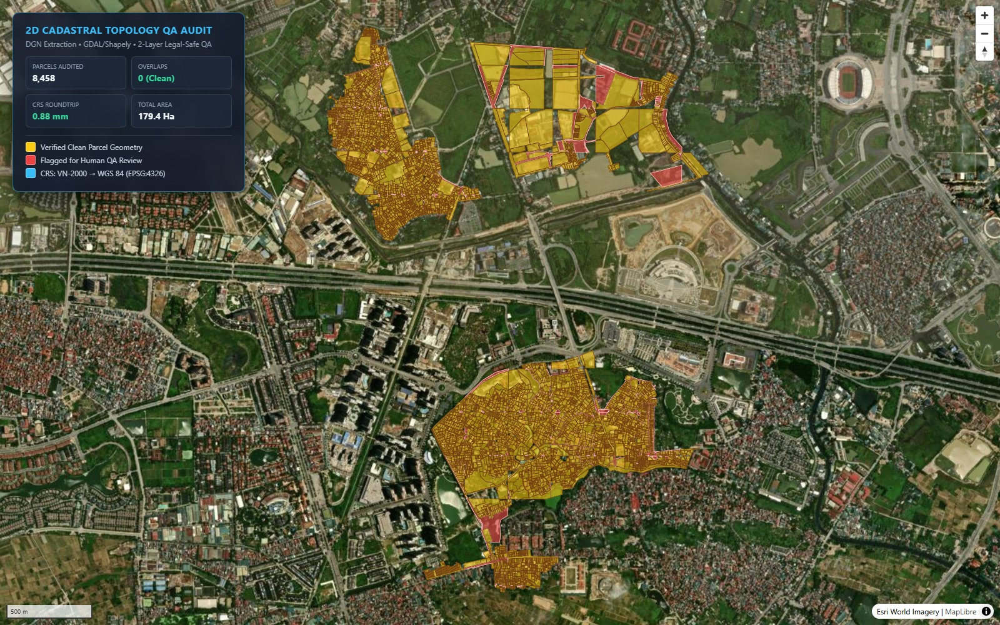

# CAD-to-GIS Topology QA/QC & WebGIS Pipeline

Production geospatial QA/QC engine built on **GDAL/OGR, PyProj, and Shapely** using a **2-Layer Legal-Safe (Human-in-the-Loop)** architecture.

Designed to ingest messy CAD (`DGN V7/V8`, `DWG`, `DXF`) and GIS (`SHP`, `GeoJSON`, `GPKG`, `KML`, `GML`) datasets, repair mechanical geometry defects without silently altering legal boundaries, and output audit-ready deliverables including an interactive **MapLibre GL JS** WebGIS viewer.



---

## 2-Layer Legal-Safe Architecture

1. **Layer 1 (Machine-Safe Automated Processing)**
   - Multi-format CAD/GIS ingestion (with Unicode-safe ArcPy bridge for legacy DGN/DWG when available).
   - Legacy encoding repair (TCVN3 `.VnTime` -> UTF-8 Unicode).
   - Curve linearization, self-intersection repair (`make_valid` + safe `GeometryCollection` flattening), optional exact-duplicate removal (`--dedup` via normalized WKB), line-to-polygon closing (`--polygonize`), and CAD annotation spatial join (`--join-labels`).
   - 7-parameter Helmert/Bursa-Wolf datum transformation with **< 1 mm round-trip verification**.

2. **Layer 2 (Human-in-the-Loop Audit)**
   - Boundary overlaps, slivers, and `MULTI_LABEL` anomalies are **never silently deleted or shifted**.
   - Every topological conflict is flagged with exact coordinates and exported to an Excel-ready UTF-8-SIG checklist (`_qa_errors.csv`) plus highlighted in red inside the standalone **MapLibre WebGIS HTML** report.

---

## Deliverables Generated Per Run

- `*.gpkg` — Cleaned GeoPackage in native projected CRS
- `*.geojson` — WGS84 GeoJSON ready for web/API consumption
- `*.kml` — Google Earth KML with styled error overlays
- `*_webgis.html` — Standalone MapLibre GL JS interactive QA viewer (filter clean vs. error parcels + search)
- `*_qa_errors.csv` — Excel-ready QA/QC checklist for engineers
- `*_report.json` — Machine-readable summary metrics

---

## Quick Start

Requires Python with `osgeo` (GDAL/OGR), `pyproj`, and `shapely` (runs out-of-the-box inside **QGIS LTR Python**).

```bash
python tools/cadastral_qa.py input.shp \
  --out output/cleaned \
  --auto-fix-geom \
  --dedup \
  --webgis
```

For CAD files requiring polygon closing and annotation label joins:

```bash
python tools/cadastral_qa.py drawing.dgn \
  --out output/cad_qa \
  --polygonize \
  --join-labels \
  --fix-font \
  --webgis
```

---

## Custom Geospatial Engineering

Need a custom CAD-to-GIS pipeline, PostGIS migration, or interactive MapLibre/Leaflet WebGIS built for your dataset?

- **Freelancer**: [freelancer.com/u/nexusgeo308](https://www.freelancer.com/u/nexusgeo308)
- **Fiverr**: [fiverr.com/s/ae7VwbN](https://www.fiverr.com/s/ae7VwbN)
